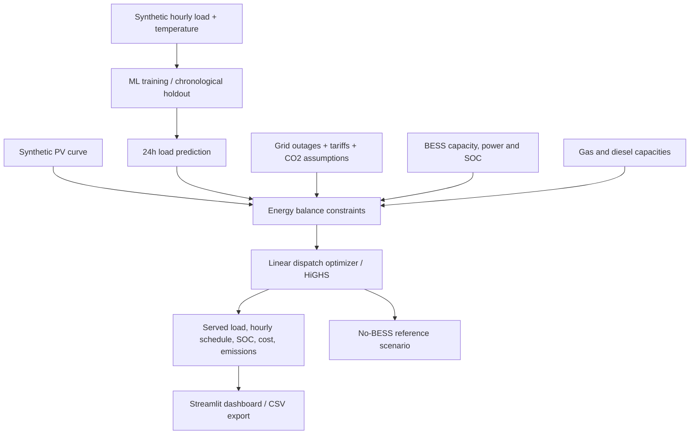

# Industrial Energy AI — PV · BESS · Gas · Diesel

> A reproducible, **synthetic-data** proof of concept for industrial energy forecasting and constrained day-ahead dispatch. Built as an engineering case study, not a certified energy-management controller.

[](https://github.com/pierremedinaw/ai-energy-optimization/actions/workflows/ci.yml)


## Executive summary

Industrial sites with solar PV and backup power face an operational scheduling problem: meet demand during grid outages without violating battery energy limits or overusing expensive backup generation. This repository demonstrates an end-to-end workflow that:

1. Generates a **clearly labeled synthetic** industrial load history.
2. Trains a gradient-boosted ML model and evaluates it using a chronological holdout.
3. Forecasts the next 24 hourly demand values.
4. Estimates photovoltaic generation from an explicitly idealized diurnal profile.
5. Optimizes an hourly schedule across grid imports, PV, BESS charging/discharging, gas engines and diesel units using **SciPy HiGHS linear programming**.
6. Compares the hypothetical outcome with a no-battery baseline and exports auditable hourly CSV files.

No cloud subscription, API key, database, real customer data or paid service is required for the MVP.

## Architecture



**Architecture decision:** a continuous LP makes energy balances, tradeoffs and constraints transparent. It is not unit commitment: generator minimum loads, start-up costs, ramp rates, fuel maps and nonlinear BESS degradation are deliberately excluded from this demonstration.

## Tech stack

- **Python 3.11+**, NumPy / pandas for energy time series.
- **scikit-learn HistGradientBoostingRegressor** for load demand prediction.
- **SciPy `linprog(method="highs")`** for dispatch scheduling.
- **Streamlit + Plotly** for the interactive dark-mode dashboard.
- **pytest + GitHub Actions** for automated tests.
- **Docker** for reproducible local deployment.

## Quick start — Windows 11 / PowerShell

Run from the directory where you extracted or cloned the repository:

```powershell
cd "D:\0 PierreMedina_com\ai-energy-optimization"
py -3.11 -m venv .venv
.\.venv\Scripts\Activate.ps1
python -m pip install --upgrade pip
python -m pip install -r requirements-dev.txt
python -m pytest -v
streamlit run app.py
```

Open <http://localhost:8501>. Stop with `Ctrl+C`.

If `py -3.11` is not installed, check `py -0p`; use a Python >= 3.11 installation. The virtual environment folder `.venv` is ignored by Git.

### Linux / macOS

```bash
python3 -m venv .venv
source .venv/bin/activate
python -m pip install -r requirements-dev.txt
python -m pytest -q
streamlit run app.py
```

## CLI (without Streamlit)

```powershell
energy-opt --date 2026-10-20 --outages 18 19 20 --output outputs/dispatch.csv
```

The CLI prints validation MAE, baseline MAE, demand, reliability, estimated cost and comparison with a no-BESS scenario. The CSV includes hourly powers, SOC and balance residual. All values are based on synthetic assumptions.

## Docker

```powershell
docker build -t ai-energy-optimization:local .
docker run --rm -p 8501:8501 ai-energy-optimization:local
```

Open <http://localhost:8501>. This is a local demo, not a hardened multi-user production application.

## Dataset and methodological integrity

- The entire historical dataset is **generated**, not collected from a plant or client.
- For each run, the previous 120 days are generated (2,880 hourly samples).
- The first 80% of samples train a validation model; the last 20% are held out chronologically.
- A **same-hour-previous-day persistence model** is used as a baseline comparator.
- A separate final model is fit on all available history to forecast the 24 hours of the requested date.
- Features include hour cyclic encodings, weekday/weekend and an idealized available temperature forecast; no future demand is used as a feature.
- Errors are reported as MAE in kW. They are **not** evidence of performance on real industrial sites.

## Optimization model

For each hour, with powers in kW:

```
PV_used + grid + gas + diesel + discharge + unserved = demand + charge
SOC_next = SOC_current + eta_charge * charge * dt - discharge * dt / eta_discharge
PV_used = PV_available - PV_curtailed
```

The optimizer respects:

- Maximum imported grid power; imports forced to zero in selected outage hours.
- PV curtailment bounds and nonnegative generation.
- BESS rated energy and charge/discharge power, minimum/maximum SOC and charging losses.
- Terminal SOC >= initial SOC (to avoid free net discharge of the starting battery).
- Installed capacity limits of generic gas and diesel generation.
- Nonnegative load shedding, heavily penalized in the objective.

The objective minimizes energy purchase / marginal generation cost + battery throughput allowance + optional carbon pricing + large unmet-load penalty. One can change installed capacities, tariffs, outage schedule and carbon price in the sidebar.

**Reporting nuance:** the dashboard's operating cost excludes the cost penalty for unmet load (an objective modeling device), capital expenditure, fixed O&M and demand tariffs. When comparing cases, inspect **both** cost and energy not served.

## Example reproducible run (synthetic)

Command:

```powershell
energy-opt --date 2026-10-20 --outages 18 19 20
```

A validated development run produced:

| Demonstration metric | Example value |
|---|---:|
| ML holdout MAE | 2.52 kW |
| 24-hour persistence MAE | 5.62 kW |
| Predicted demand | 1,335.91 kWh |
| Reliability with BESS | 100% |
| Unserved energy with BESS | 0.00 kWh |
| No-BESS operating cost | 192.76 EUR |
| BESS operating cost | 188.32 EUR |

**Not measured savings or claimed field performance.** These figures are specific to synthetic input, default assumptions, a historical simulation date and this exact algorithm. Modifying costs, plant size or outage hours can reverse the comparison. Do not use these figures in a professional claim without labeling them as simulated.

## Jenbacher, industrial gas and backup integration

The generic **gas** asset represents the kind of power generation unit that might use a natural-gas engine, including Jenbacher-class applications. This project does **not** assert manufacturer specifications, performance maps, fuel consumption or availability for any specific Jenbacher or diesel unit.

To develop a site-specific study, replace idealized inputs with licensed/authorized technical data including:

- Nominal / derated real and reactive power limits; site elevation, ambient temperature and fuel quality.
- Heat-rate and specific fuel consumption versus part-load; start/stop and maintenance costs.
- Minimum stable loading, ramp and startup constraints, warmup duration, grid-forming requirements.
- BESS charge/discharge curves, warranted cycles, SoH, conversion efficiencies and reserve policy.
- Site load metering, PV forecasts, utility tariffs, outage schedule and local emissions coefficients.

A realistic next step is mixed-integer unit commitment plus scenario-aware (stochastic or robust) dispatch and electrical-engineering validation.

## Project layout

```text
ai-energy-optimization/
├── .github/workflows/ci.yml
├── .streamlit/config.toml
├── src/energy_opt/
│   ├── __init__.py
│   ├── cli.py
│   ├── dispatch.py
│   ├── forecast.py
│   ├── pipeline.py
│   └── scenario.py
├── tests/
│   ├── test_dispatch.py
│   ├── test_forecast.py
│   └── test_pipeline.py
├── .dockerignore
├── .gitignore
├── app.py
├── Dockerfile
├── LICENSE
├── pyproject.toml
├── README.md
├── requirements-dev.txt
└── requirements.txt
```

## Quality and release workflow

```powershell
python -m pytest -v
python -m energy_opt.cli --date 2026-10-20

git status
git check-ignore -v .venv
git diff --cached --name-only
```

Do not commit local `.env`, exported secrets or customer files. The initial MVP uses no credentials.

## Delivery plan / roadmap

| Phase | Deliverable | Additional infrastructure cost |
|---|---|---:|
| **1 — Local MVP (current)** | Forecast + LP dispatch + Streamlit + CLI + tests | **€0** |
| 2 — Validation & energy realism | Asset-specific curves, generator commitment, time-series evaluation, sensitivity study | €0 software; data licensing may vary |
| 3 — Cloud / MLOps (optional) | Container image, CI, model registry, cloud storage / scheduled runs | Depends on chosen platform; keep free locally until limits verified |
| 4 — Portfolio integration | Public GitHub repo, architecture diagram, anonymized case study on pierremedina.com | €0 incremental |

## Security & limitations

- Free and local by default: no real cloud API, billing account or credentials required.
- Forecast is trained **only on synthetic data**. Input forecasts (e.g. weather) are idealized.
- Continuous LP omits integer operational statuses; simultaneous charge/discharge is not mathematically prohibited in all edge cases.
- A 1 h interval hides power transients, start-up dynamics and protective-relaying constraints.
- This tool is for **educational/research prototyping only**; do not connect to a plant or use as the sole basis for dispatch decisions.

## License

[MIT](LICENSE) — 2026 Pierre Medina.
